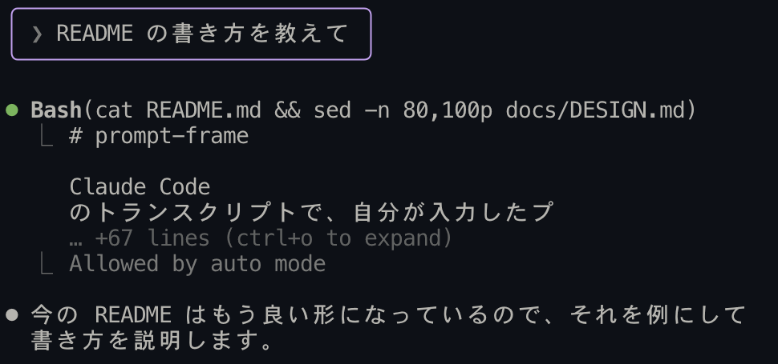
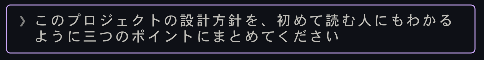
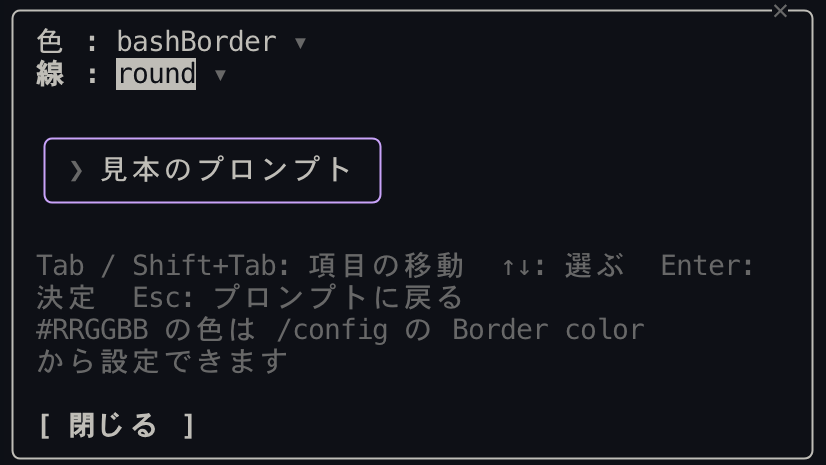

# prompt-frame

Claude Code のトランスクリプトで、自分が入力したプロンプトだけを色付きの枠で囲むプラグインです。長い会話でも、自分がどこで何を頼んだかをすぐに見つけられます。



## 特徴

- ターミナルで自分が打ったプロンプトだけを囲む。通知や他のエージェントからのメッセージはそのまま
- 長いプロンプトは枠の中で折り返す。枠は本文の幅に合わせて縮む
- `/prompt-frame` で開くパネルから、枠の色と線の種類を見本を見ながら変えられる
- 表示を変えるだけで、保存されるメッセージやモデルに渡る内容は変えない
- ネットワークにアクセスせず、プロンプトの内容をどこにも保存しない



## インストール

Claude Code のプロンプトで次を実行します。

```
/plugin install prompt-frame --marketplace futosawaguchi/prompt-frame
```

`Add marketplace?` と聞かれたら `y` を押し、インストール先（スコープ）を選びます。インストールしたセッションからすぐに有効になります。

シェルからインストールする場合:

```sh
claude plugin install prompt-frame --marketplace futosawaguchi/prompt-frame
```

> リポジトリが private のあいだは、GitHub でこのリポジトリを読める人だけがインストールできます。その人のパソコンに github.com の認証情報（SSH 鍵、または `gh auth login` のあと `gh auth setup-git`）が必要です。

## 使い方

インストールすると、ターミナルで入力したプロンプトが自動で枠に囲まれます。

### 色と線の種類を変える

`/prompt-frame` で設定パネルが開きます。



| キー | 操作 |
| --- | --- |
| Tab / Shift+Tab | 項目（色・線・閉じる）を移動 |
| ↑ / ↓ | 値を選ぶ |
| Enter | 決定 |
| Esc | プロンプトに戻る |

選ぶとすぐに枠に反映されます。`#RRGGBB` の色は、`/config` を開いて「Border」で絞り込み、Border color に入力します。

### 設定項目

| キー | 既定値 | 取りうる値 |
| --- | --- | --- |
| `borderColor` | `suggestion` | テーマの色キー（`suggestion`、`claude`、`success`、`warning`、`permission`、`planMode` など）または `#RRGGBB` |
| `borderStyle` | `round` | `round` `single` `double` `bold` `dashed` `classic` |

テーマの色キーを使うと、テーマを切り替えたときに見やすい色へ自動で変わります。

## 対応している環境

- Claude Code のターミナル版。desktop / VS Code / モバイルでは枠を出さず、通常の表示のままです。
- 動作を確認した版: Claude Code 2.1.322

## アンインストール

```
/plugin uninstall prompt-frame
```

## 開発

```sh
git clone https://github.com/futosawaguchi/prompt-frame.git
cd prompt-frame

# このフォルダのプラグインを読み込んで起動する（保存すると再読み込みされる）
claude --plugin-dir .

# 検証とテスト
claude plugin validate .
claude plugin test .
```

## ライセンス

[MIT](LICENSE)
